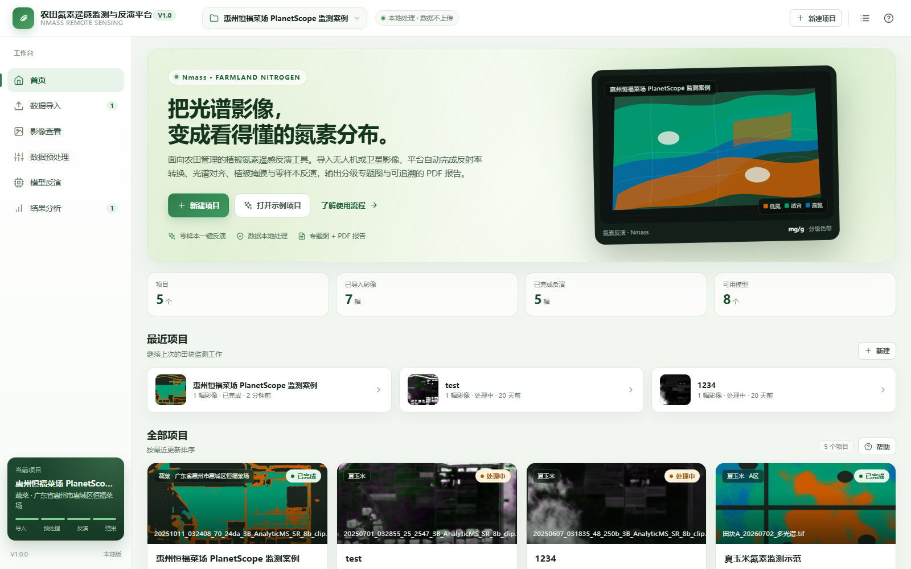
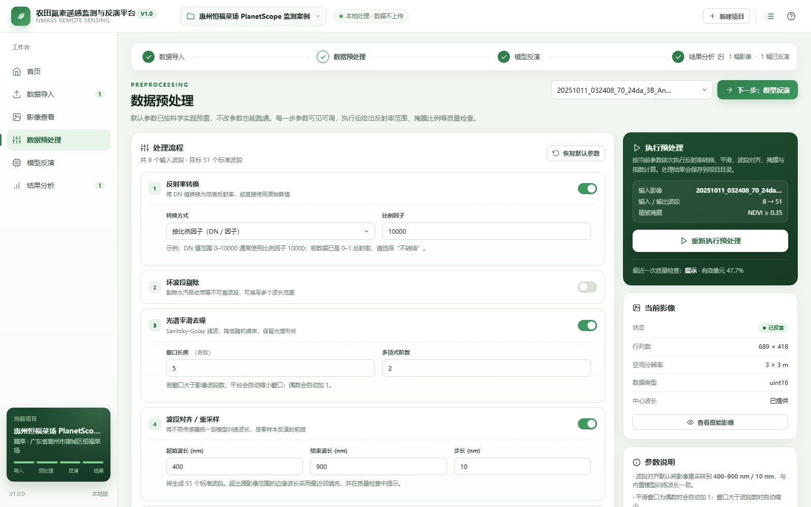
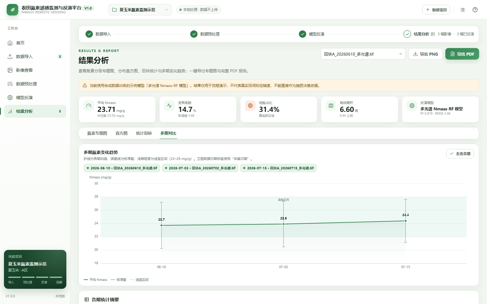
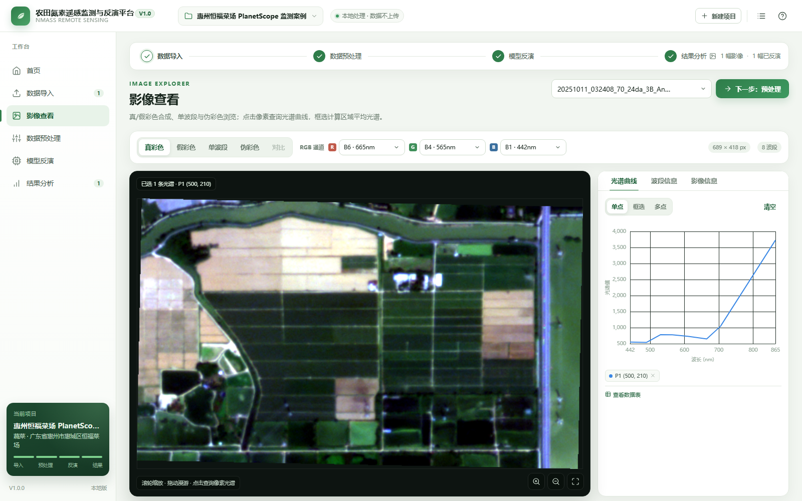
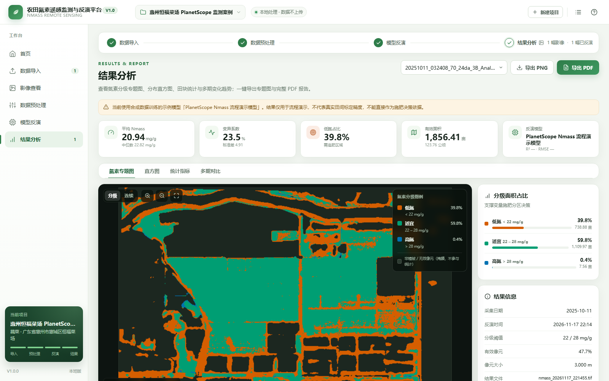

# FreeFarmNRS V1.0

> 面向农业应用的植被氮素含量（Nmass）遥感反演工具  
> Web 本地单机版 · Windows 10/11 · 数据仅在本机处理



从多光谱 / 高光谱 / 卫星影像到田块氮素分级专题图：影像导入 → 预处理 → 模型反演 → 统计分析与 PDF 报告，全流程在浏览器中完成。项目内置合成示例项目，并包含用户提供的 PlanetScope 真实影像本地展示案例。

## 目录

- [功能概览](#功能概览)
- [界面预览](#界面预览)
- [快速开始](#快速开始)
- [使用流程](#使用流程)
- [内置模型与自定义模型](#内置模型与自定义模型)
- [数据存储](#数据存储)
- [技术架构](#技术架构)
- [已实现范围与后续计划](#已实现范围与后续计划)
- [示例输出](#示例输出)
- [常见问题](#常见问题)

## 功能概览

| 模块 | 能力 |
|------|------|
| 项目管理 | 项目目录制存储、项目卡片与封面、最近项目、项目切换、删除、处理日志 |
| 数据导入 | GeoTIFF、ENVI；批量导入；自动解析 ENVI/GeoTIFF 标签、AUX.XML、JSON、XMP、PlanetScope STAC/XML、文件名日期与田块；逐字段来源/置信度；重解析对比且保留用户值 |
| 影像查看 | 真彩色、假彩色、单波段灰度、伪彩色；RGB 通道自由组合；多期卷帘对比；缩放、漫游；单像素光谱、区域平均光谱、多点叠加对比；波段/影像信息面板 |
| 数据预处理 | 反射率转换、坏波段剔除、Savitzky-Golay 平滑、波段对齐、植被掩膜、云检测、ROI 裁剪、植被指数（NDVI/NDRE/CIredge/GNDVI）；参数可见可调；质量检查；NDVI/掩膜预览；进度可视化 |
| 模型反演 | 内置及 DNN 合成示例模型；服务端集中适用性预检；推荐/可重采样/不兼容/信息不足状态；单幅和逐影像批量预检；显式确认告警；自定义模型试推理、SHA-256、安全确认；基于实测样点的 few-shot 后校准派生模型 |
| 结果分析 | 分级/连续专题图、像元查询、直方图、统计、多期趋势；实际模型单位贯穿页面/PNG/PDF；模型哈希、训练波长、重采样、边缘填充、预处理摘要和强制告警追溯 |
| 交互体验 | 左侧菜单 + 顶部项目栏；四阶段步骤条；新手引导；帮助；处理日志；所有参数预置科学默认值 |

## 界面预览

| 影像查看与光谱曲线 | 氮素分级专题图 |
|---|---|
|  |  |

| 数据预处理 | 多期趋势对比 |
|---|---|
|  |  |

PlanetScope 实景案例：

| 影像查看与光谱查询 | 流程演示结果 |
|---|---|
|  |  |

更多截图见 [docs/screenshots/](docs/screenshots/)。截图已统一使用当前正式名称；PlanetScope 实景页面见 `11_planetscope_home.png` 至 `16_planetscope_results.png`，Few-shot 实测校正界面见 `17_fewshot_modal.png`。

## 快速开始

### 环境要求

- Windows 10 / 11
- Python 3.9+（当前环境实测 3.9.7）
- Chrome / Edge 等现代浏览器
- 首次安装依赖时需要网络；运行平台本身完全离线

### 启动

项目内已准备好 `.venv` 虚拟环境与示例数据，直接双击：

```text
启动平台.bat
```

服务启动后会自动打开浏览器，默认地址：

```text
http://127.0.0.1:8765/
```

关闭启动窗口即可停止服务。API 文档位于 `http://127.0.0.1:8765/api/docs`。

### 重新安装依赖

如需在其他机器或全新环境运行：

```bat
python -m venv --system-site-packages .venv
.venv\Scripts\python.exe -m pip install -i https://mirrors.aliyun.com/pypi/simple/ --trusted-host mirrors.aliyun.com -r requirements.txt
```

> Python 3.9 下需使用 `reportlab >= 4.0, < 5`（requirements.txt 已限定）。  
> `.onnx` 模型支持所需的 `onnxruntime` 已列入 requirements。

开发与验收依赖：

```bat
.venv\Scripts\python.exe -m pip install -r requirements-dev.txt
.venv\Scripts\python.exe -m pytest -q
```

### 重新生成示例 / 示例模型

```bat
.venv\Scripts\python.exe -m server.tools.seed_demo --force
.venv\Scripts\python.exe -m server.tools.train_demo_models
.venv\Scripts\python.exe -m server.tools.verify_dnn_models
```

示例影像由平台内置光谱模拟器（`server/services/spectral_sim.py`）生成，仅用于功能演示，不代表真实田块。

### PlanetScope 本地展示案例

仅在本机建立用户提供的 PlanetScope 展示项目：

```bat
.venv\Scripts\python.exe -m server.tools.create_planetscope_case
```

脚本仅把指定裁剪影像与同名 STAC JSON、简化 JSON、产品 XML 复制到 `data/projects/planet_hengyu_case/`。地点“广东省惠州市惠城区恒福菜场”来自用户说明，不由坐标反向编造。原始数据不得随公开源码仓库发布。

## 使用流程

### 1. 新建 / 打开项目

- 首页点击「新建项目」，填写项目名称、作物、田块编号。
- 或点击「打开示例项目」直接打开内置示例：夏玉米三期多光谱 + 高光谱试验田。

### 2. 数据导入

- 支持一次选择多幅影像；ENVI 需同时选择同名 `.hdr` 与 `.dat/.img`，也可同时选择 `.aux.xml`、JSON、XML、XMP 侧车。
- 平台自动解析 ENVI/GeoTIFF 标签、侧车、PlanetScope STAC/XML 和文件名规则，并显示每种字段的来源与置信度。
- 重新解析前显示新旧值对比；用户手工修改的字段默认保留。解析不到时字段显示“待人工确认”，不会编造传感器、日期或具体地点。
- 未填波长时仍可浏览影像，但光谱横轴变为波段序号，波段对齐与植被指数会给出提示。

### 3. 影像查看

- 真彩色 / 假彩色 / 单波段 / 伪彩色 / 对比五种模式。
- 单点：点击像素查询光谱；框选：拖拽区域计算平均光谱；多点：最多叠加 5 条曲线。
- 对比模式拖动中轴进行卷帘对比（需要同一项目至少 2 幅影像）。

### 4. 数据预处理

- 默认参数已预置，直接执行即可跑通。
- 关键默认值：比例因子 10000、SG 窗口 5 / 阶数 2、目标波长 400–900 nm / 10 nm、NDVI 阈值 0.35。
- 执行后查看质量检查（反射率范围、掩膜比例、波段对齐、云检测），并预览真彩色 / NDVI / 掩膜。
- 重新预处理会覆盖处理结果并回退影像状态；旧反演结果文件仍保留，但请以最新状态为准。

### 5. 模型反演

- 选择影像和模型后，服务端计算作物、传感器、精确/插值/边缘填充波段与总体适用性；模型卡显示推荐、可重采样、不兼容或信息不足。
- 切换影像会重新计算推荐模型；不兼容模型禁止运行，存在警告时必须二次确认，服务端会在执行时再次校验。
- 可调整模型实际单位下的低氮/高氮分级阈值。
- 未预处理的影像可勾选「自动执行默认预处理」。
- 批量反演弹窗逐幅显示预检结果；含不兼容影像时默认拒绝，警告需显式确认。
- 已有基础反演结果时，可使用带实测 Nmass 的样点生成 few-shot 派生模型，并在当前影像上重新计算校正结果。

### 6. 结果分析与导出

- 专题图：分级/连续两种色带，图例含分级范围、面积占比与掩膜说明；点击像元查询 Nmass。
- 直方图：均值线 + 分级阈值线，可展开分箱数据表。
- 统计指标：均值、标准差、变异系数、分位数、有效像元、有效面积、分级面积。
- 多期对比：均值折线 + 标准差误差线 + 适宜区间，附各期统计摘要表。
- 导出：带图例/比例尺/指北针的 PNG 与 PDF；单位、模型名称、文件哈希、训练波长、重采样/边缘填充、预处理配置摘要和强制告警均进入结果追溯。

### 7. Few-shot 实测校正

Few-shot 在本平台中指“少样本后校准”，不是修改父模型的全部权重。流程如下：

1. 先用模型库中的基础模型完成当前影像反演。
2. 在结果页提供带实测 Nmass 的样点。CSV 可使用 `sample_id,col,row,nmass`（预处理栅格 0 基坐标），或使用 `sample_id,lon,lat,nmass`（WGS84 经纬度）。模板见 `docs/examples/few_shot_samples_template.csv` 与 `docs/examples/few_shot_samples_lonlat_template.csv`。
3. 平台按 `col,row` 从当前结果栅格读取基础预测值，并与实测值配对。
4. 1–2 个有效样点执行整体偏置校正；3–4 个采用收缩线性校正；5 个及以上执行偏置/斜率后校准。
5. 平台计算校正前后 MAE、RMSE、偏差、R² 和留一验证指标。
6. 确认后生成 `few_shot_calibrated` 派生模型。派生模型记录父模型、样点、系数、误差、单位和 SHA-256，不复制父模型二进制权重。
7. 当前影像使用派生模型重新反演；原结果摘要、栅格和预览复制到 `results/calibration_sources/<model_id>/`。

派生模型可以在后续影像上复用，但样点仍代表有限的本田/本传感器经验。平台不会把 few-shot 校正说成完整模型重训练，也不会用少量样点重新评价父模型的科学适用性。

## 内置模型与自定义模型

内置模型均带有「示例」标识，基于合成冠层光谱训练，**仅用于功能演示**：

| 模型 | 算法 | R² | RMSE | 适用 |
|---|---|---:|---:|---|
| 通用 Nmass-NDRE/NDVI 经验模型 | 植被指数回归 | 0.940 | 1.43 | 多光谱/高光谱快速预览 |
| 多光谱 Nmass-RF 模型 | 随机森林 | 0.819 | 2.46 | 五波段（475/560/668/717/840 nm） |
| 玉米 Nmass-PLSR 模型 | PLSR | 0.946 | 1.35 | 全谱段高光谱/多光谱 |
| 小麦 Nmass-随机森林模型 | 随机森林 | 0.979 | 0.85 | 全谱段 |
| 通用 Nmass-SVR 模型 | SVR | 0.988 | 0.63 | 全谱段 |
| 全谱 51 波段 Nmass-DNN 示例模型 | 两层 MLP（128/64） | 0.9835* | 0.7398 | 400–900 nm / 51 波段 |
| 五波段 Nmass-DNN 示例模型 | 两层 MLP（64/32） | 0.7797* | 2.6417 | 475/560/668/717/840 nm |

\* DNN 指标来自 7200 条合成光谱的完全独立测试集（80%/10%/10% 划分），不是对当前影像或 PlanetScope 案例的精度验证。

`planet_nmass_demo` 是 PlanetScope 案例专用流程演示元数据，复用 51 波段 DNN 合成示例权重。PlanetScope 实景结果只用于验证重采样、反演、统计和报告流程，不代表真实田间标定精度。

正式科研与生产应用请导入基于实测氮素数据训练的模型：

> 安全提示：`.pkl` / `.joblib` 属于 pickle 格式，加载时可能执行任意代码，请仅导入可信来源的模型文件。

- 支持 `.pkl` / `.joblib`（scikit-learn Pipeline / 具备 `predict` 的对象）。
- 支持 `.onnx`（单输入，形状 `(N, B)`）。
- 训练波长必须至少 2 个、100–20000 nm、严格递增且无重复，数量需与模型输入特征数一致。
- 导入时执行确定性模拟输入试推理，检查输出数量、形状、NaN/Inf；成功后在元数据中保存 SHA-256 与试推理结果。
- 支持填写低氮/高氮阈值、实际单位、适用作物、传感器、R²/RMSE、训练数据说明和指标类型。
- 支持通过派生模型执行 few-shot 偏置/收缩线性后校准；校正不修改父模型文件。

## 数据存储

所有数据保存在 `data/` 下，不上传外网：

```text
data/
├── projects/
│   └── <project_id>/
│       ├── project.json          # 项目与影像元数据
│       ├── cover.png             # 项目封面（优先使用结果专题图）
│       ├── logs/project.jsonl    # 处理日志
│       └── images/<image_id>/
│           ├── source/           # 原始影像
│           ├── processed/
│           │   ├── stack.npz     # 预处理光谱栈（float16 压缩）
│           │   ├── mask.npy      # 植被掩膜
│           │   ├── indices/      # 植被指数数组
│           │   ├── previews/     # 真彩色/NDVI/掩膜预览
│           │   └── meta.json     # 参数、质量检查、指数统计
│           └── results/
│               ├── nmass_*.tif   # GeoTIFF 结果
│               ├── nmass_latest.npy
│               ├── latest.json   # 统计摘要（多期对比依据）
│               ├── previews/     # 分级/连续专题图
│               ├── calibration_sources/ # few-shot 校正前结果快照
│               └── exports/      # PNG/PDF 导出
└── models/                       # 用户导入的自定义模型
```

整目录复制即可备份或迁移项目。单个项目也可直接在 `data/projects` 下拷贝。

## 技术架构

- **后端**：FastAPI + Uvicorn；Rasterio/GDAL 读写 GeoTIFF/ENVI；NumPy/SciPy/scikit-learn 处理与模型；Matplotlib + ReportLab 生成专题图与 PDF。
- **前端**：Vue 3（本地文件，免构建、完全离线）+ ECharts + 原生 Canvas 影像视图；无 CDN、无外网依赖。
- **任务**：线程化后台任务 + 进度轮询；反演按行分块处理。
- **存储**：项目目录制 JSON + NPZ/NPY + GeoTIFF + PNG/PDF。

主要后端模块：

```text
server/
├── main.py                 # FastAPI 入口与静态文件
├── core/                   # 配置、项目存储、通用工具
├── api/                    # 项目、影像、预处理、模型、结果、任务、系统接口
├── services/
│   ├── raster.py           # 元数据解析、预览、光谱提取、重采样
│   ├── image_metadata.py   # ENVI/GeoTIFF/侧车/PlanetScope 统一元数据
│   ├── preprocess.py       # 预处理流水线与质量检查
│   ├── inference.py        # 反演、分级统计、结果落盘
│   ├── models.py           # 模型注册、加载与导入
│   ├── model_compatibility.py # 集中式适用性预检
│   ├── few_shot.py         # 实测样点后校准与派生模型
│   ├── report.py           # PNG 专题图与 PDF 报告
│   ├── demo.py             # 示例项目生成
│   └── spectral_sim.py     # 合成冠层光谱
├── builtin_models/         # 内置示例模型
└── tools/                  # 示例数据/模型生成脚本
```

## 已实现范围与后续计划

### 已实现

- 数据输入：GeoTIFF/ENVI 导入、批量、ENVI/GeoTIFF/AUX.XML/JSON/XMP/PlanetScope 侧车自动解析、逐字段来源、重新解析对比、用户值保护、项目制存储、日志。
- 数据显示：真/假彩色、单波段、伪彩色、卷帘对比、缩放漫游、单点/区域/多点光谱、波段与影像信息。
- 预处理：反射率转换、坏波段、SG 平滑、波段对齐、植被掩膜、简单云检测、ROI 裁剪、常用植被指数、质量检查、预览。
- 模型：内置 5 个传统示例模型、两个真实可推理 MLP 示例、服务端集中适用性预检、影像切换重选、逐影像批量预检、警告二次确认、自定义模型试推理与文件哈希、few-shot 实测样点后校准派生模型。
- 结果：分级/连续专题图、像元值查询、直方图、统计指标、分级面积、多期趋势、PNG/PDF 导出和完整模型/重采样/预处理追溯。
- 真实案例：用户提供的 PlanetScope PSScene 8 波段地表反射率裁剪影像，独立本地展示项目、STAC/XML 自动解析、云量冲突提示及流程演示结果。
- 界面：左侧菜单、顶部项目栏、四阶段步骤条、新手引导、帮助、日志、参数默认值、本地离线。

### 当前限制 / 后续计划

1. **大影像内存占用**：当前预处理与反演会将整幅影像载入内存（上限约 5 亿像元值），超大高光谱影像建议先裁剪。后续计划：分块流水线 + 金字塔瓦片显示。
2. **内置模型为合成示例**：精度指标仅代表演示数据，不能直接用于生产决策；请导入实测标定模型。
3. **云检测为蓝光阈值法**：适用于简单场景；后续接入 SCL/云概率产品。
4. **多期影像自动配准（FR-PP-09）尚未实现**：当前多期对比假设影像已配准或同一飞行区域。
5. **few-shot 的能力边界**：当前采用偏置/收缩线性后校准，统一支持现有模型；不直接更新 PLSR、随机森林、SVR、DNN 的全部权重，也不是使用大量实测数据重新训练模型。1–2 个样点只能做偏置校正，正式应用建议至少 5 个空间独立的实测样点。
6. **辐射传输模型（PROSAIL/LESS）**：当前以光谱机器学习与植被指数经验模型为主，后续可接入 LUT/优化反演。
7. **ONNX**：已支持单输入 `(N, B)` 模型（`onnxruntime` 已列入依赖）；不支持多输入或带自定义前处理的模型。
8. **重新预处理与结果状态**：重新预处理会让影像状态回退，旧结果文件保留；结果页读取的是最近一次反演摘要。
9. **PlanetScope 不是实测氮素验证集**：本案例只验证真实卫星数据的元数据、显示和流程能力；内置合成模型输出不能用于该菜场的真实施肥决策。
10. **暂不支持的真实厂商侧车**：除 PlanetScope PSScene STAC/XML、MicaSense 结构 XMP、GDAL AUX.XML 与通用 JSON 外，尚未逐一实现 DJI、Headwall、SPECIM 等厂商私有侧车格式。

## 示例输出

- [氮素专题图示例（PNG）](docs/examples/氮素专题图示例.png)
- [氮素反演报告示例（PDF）](docs/examples/氮素反演报告示例.pdf)
- [PlanetScope 恒福菜场流程演示专题图（PNG）](docs/examples/PlanetScope恒福菜场_流程演示专题图.png)
- [PlanetScope 恒福菜场流程演示报告（PDF）](docs/examples/PlanetScope恒福菜场_流程演示报告.pdf)

## 常见问题

**Q：双击启动脚本后浏览器没有自动打开？**  
A：手动访问 `http://127.0.0.1:8765/`。若端口被占用，可通过环境变量 `NMASS_PORT` 修改端口后重新启动。

**Q：ENVI 影像导入失败？**  
A：请确认 `.hdr` 与 `.dat/.img` 同名且一起选择；缺少头文件时平台会提示。头文件损坏也会给出“无法读取影像”的中文提示。

**Q：光谱横轴只有波段序号？**  
A：影像头文件和侧车未提供波段中心波长。前往「数据导入」页重新解析，或人工补充（数量必须等于波段数），保存后重新预处理。

**Q：自动重新解析会不会覆盖我改过的传感器、日期或地点？**  
A：不会。用户来源字段优先保留；重新解析弹窗会显示新旧值对比及被保留字段。

**Q：JSON 和 XML 的云量不一致怎么办？**  
A：平台保留两个原始值及来源并显示冲突提示，等待人工确认，不静默选择其中一个。

**Q：反演结果为什么几乎都是某一等级？**  
A：检查影像是否已完成反射率转换、波段波长是否正确、所选模型是否适用于当前传感器/作物；示例模型基于合成数据，换用实测模型效果更可靠。

**Q：PDF 中文乱码或导出失败？**  
A：PDF 使用系统 `SimHei` 字体（Windows 自带）。若系统缺少该字体，可安装中文字体或替换 `server/services/report.py` 中的字体路径。

**Q：数据会不会上传？**  
A：不会。所有处理与结果均在本机完成；前端只访问 `127.0.0.1` 本地服务。

---

**版本**：V1.0 · 本地单机版  
**需求依据**：《农田氮素遥感监测与反演平台 — 功能需求文档 v1.0（定稿）》  
**技术栈**：Python 3.9 / FastAPI / Rasterio / scikit-learn / Vue 3 / ECharts
